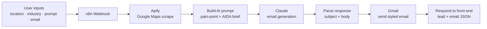

# NearbyNudge

**AI-powered local prospecting — find nearby businesses, write hyper-personalized cold outreach, and send it, all from three inputs.**


> Capstone project for **MKTG 6290 – AI in Marketing** at the George Washington University (Team 3).

---

## Overview

Local B2B teams — the agency, the SaaS reseller, the marketing freelancer selling to
dentists, gyms, and auto shops — waste hours hunting for leads on Google Maps and then get
ignored because their cold emails read like templates. Existing tools assume you *already*
have a lead list; none are built for discovering **local** prospects and personalizing to
each one.

**NearbyNudge** closes that gap. From three inputs — a **location**, an **industry**, and a
short **outreach prompt** — it:

1. Discovers real nearby businesses from Google Maps (name, rating, reviews, website, phone).
2. Detects each lead's most relevant **pain point / hook** (no website, thin reviews, low
   rating, or a strong reputation ripe for growth).
3. Generates a **hyper-personalized** cold email with Anthropic Claude using an AIDA
   copywriting brief.
4. Sends a polished HTML email to the user's inbox and returns the lead + copy to the UI.

The result is a working end-to-end prototype that takes a user from a blank form to a
personalized outreach email in about two minutes.

## Key Features

- **Zero-list prospecting** — no CSV uploads or purchased lists; leads are discovered live
  from Google Maps by location + industry.
- **Signal-based pain-point detection** — deterministic rules classify each business (missing
  website, `< 10` reviews, `< 4.0` stars, or high-reputation) and pick the sharpest hook.
- **AIDA-driven AI copywriting** — Claude writes a subject line and 80–130 word body tuned to
  each lead, with guardrails (no clichés, one low-friction CTA, opt-out line).
- **Automated delivery** — a branded, responsive HTML email is sent via Gmail.
- **Single-file front-end** — a polished landing page plus an interactive dashboard
  (Dashboard, Campaigns, Leads, Emails, Settings, and a live "New Campaign" flow) in one
  dependency-free HTML file.
- **No-code backend** — the entire pipeline is an importable n8n workflow.

## How It Works



The front-end (`app/index.html`) POSTs the four fields to the n8n webhook and renders the
returned lead card and generated email. The workflow (`workflow/nearbynudge.json`) runs the
seven-step pipeline above.

## Tech Stack

| Layer            | Technology                                                        |
| ---------------- | ----------------------------------------------------------------- |
| Front-end        | HTML5, CSS3, vanilla JavaScript (single-file SPA, no build step)  |
| Orchestration    | [n8n](https://n8n.io) low-code workflow automation                |
| Lead discovery   | [Apify](https://apify.com) Google Places / Maps crawler           |
| AI copywriting   | [Anthropic Claude](https://www.anthropic.com) Messages API        |
| Email delivery   | Gmail (via n8n OAuth2 node)                                        |
| Hosting          | Any static host for the front-end (Vercel / Netlify / GitHub Pages) |

## Repository Structure

```text
NearbyNudge/
├── app/
│   └── index.html          # Front-end SPA — landing page + campaign dashboard
├── workflow/
│   └── nearbynudge.json     # n8n workflow to import (webhook → scrape → AI → email)
├── docs/
│   └── NearbyNudgeAI-Capstone-Presentation.pdf   # Capstone deck (problem, market, demo)
├── .env.example            # Config template — copy to .env and fill in real keys
├── .gitattributes          # Line-ending normalization
├── .gitignore              # Ignores .env, caches, OS/editor files
├── vercel.json             # Static-hosting rewrite (serves app/index.html at /)
├── LICENSE                 # MIT
└── README.md
```

> Real API keys live only in a git-ignored `.env` (never committed). The workflow reads them
> at runtime via `{{ $env.* }}`, so nothing sensitive ever reaches the public repo.

## Setup & Installation

There is **no build step and no package install** — the front-end is a static file and the
backend is a hosted n8n workflow. You do need accounts for the external services.

**Prerequisites**

- An [n8n](https://n8n.io) instance (n8n Cloud or self-hosted)
- An [Apify](https://apify.com) account + API token
- An [Anthropic](https://console.anthropic.com) API key
- A Gmail account to send from

**1. Configure your keys**

Copy the template and fill in real values:

```bash
cp .env.example .env
```

`.env` is git-ignored, so your keys never get committed. The workflow reads them at runtime
via expressions like `{{ $env.APIFY_API_TOKEN }}` and `{{ $env.ANTHROPIC_API_KEY }}`.

**2. Import the workflow**

In n8n: **Workflows → Import from File →** select `workflow/nearbynudge.json`.

**3. Make the keys available to n8n**

Start n8n with the variables from your `.env` in its environment, and allow expressions to
read them (`N8N_BLOCK_ENV_ACCESS_IN_NODE=false`). Then, on the **Gmail** node, create/select
a **Gmail OAuth2** credential. (Prefer n8n's credential store? You can also paste keys
directly onto the Apify/Claude nodes instead of using `$env`.)

**4. Activate & copy the webhook URL**

Activate the workflow and copy the **Production URL** of the `Webhook` node
(it ends in `/webhook/nearbynudge`).

**5. Point the front-end at your webhook**

In `app/index.html`, set the `WEBHOOK_URL` constant to the URL from step 4:

```js
const WEBHOOK_URL = 'https://YOUR-N8N-HOST/webhook/nearbynudge';
```

**6. Run the front-end**

Open `app/index.html` directly in a browser, or deploy to any static host. A `vercel.json` is
included that serves `app/index.html` at the site root — just import the repo into Vercel
(or Netlify / GitHub Pages) for a live URL.

## Usage

1. Open the app and click **Try it free** / **New Campaign**.
2. Enter a **Location** (e.g. `Arlington, VA`), pick an **Industry**, write a short
   **Outreach Prompt** (your offer, tone, and CTA), and your **Email**.
3. Click **Generate & Launch Outreach**. The workflow finds a matching local business,
   writes a personalized email, sends it to your inbox, and displays the lead + copy.

## Notes on the Demo

The dashboard's charts, campaign list, and lead table use **illustrative mock data** so the
UI can be explored without a live backend. The **New Campaign** flow is the fully wired,
end-to-end path that calls the real workflow. No API keys are bundled in this repository —
supply your own as described above.

## Team

**Team 3 — MKTG 6290: AI in Marketing, The George Washington University**

- **Filippos Patsis**
- **Yusuf Arslan**
- **Rutendo Chinyku**

## Acknowledgments

Built as the capstone for **MKTG 6290 – AI in Marketing**. See
`docs/NearbyNudgeAI-Capstone-Presentation.pdf` for the full problem framing, market analysis,
and walkthrough.

## License

Released under the [MIT License](LICENSE).
